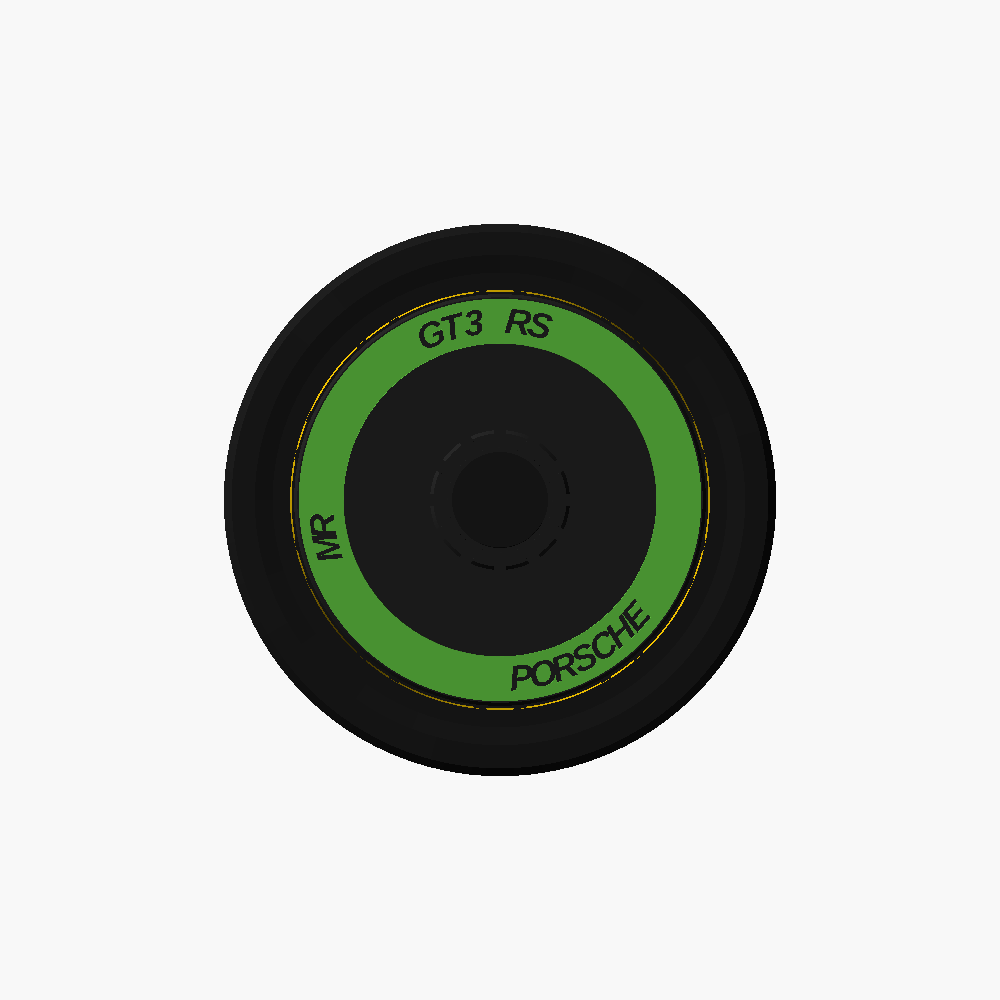
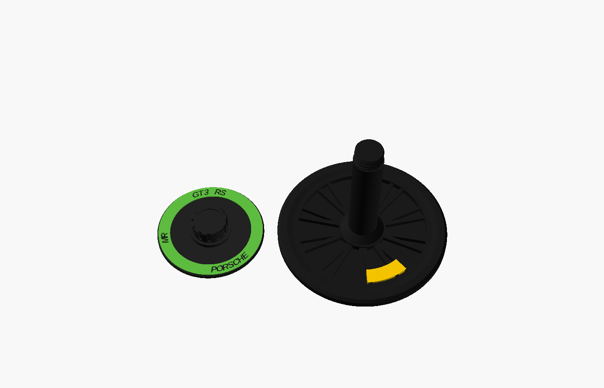
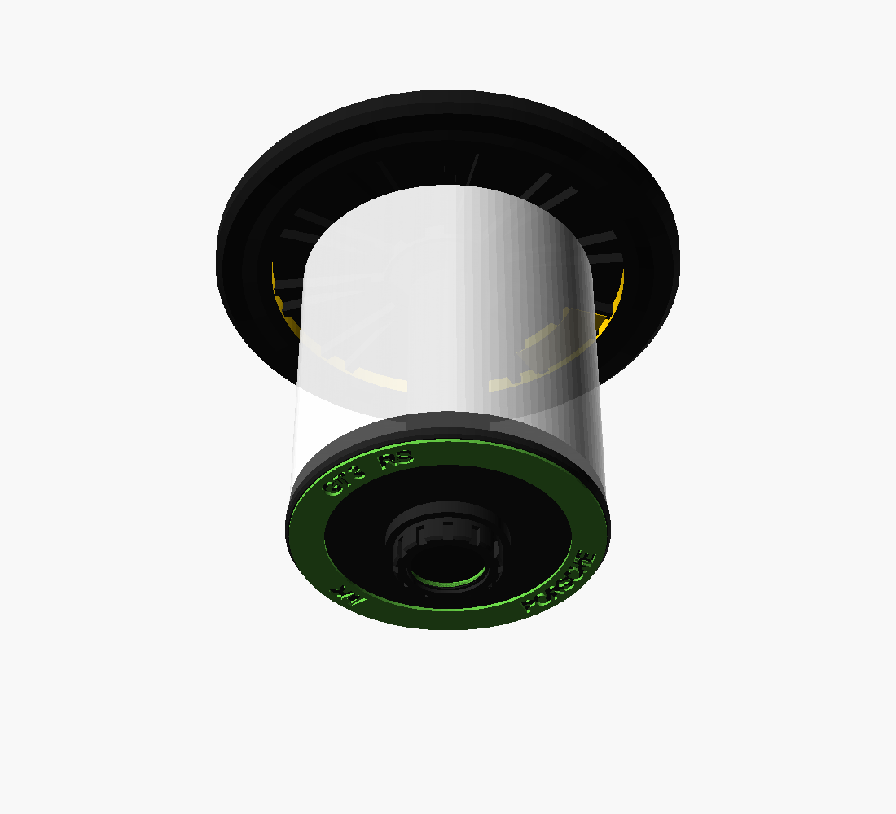

# Aero-disc wheel toilet paper holder (GT RS style)

A black multi-spoke wheel and tire mounts on the wall, with a yellow brake caliper behind the spokes. A post sticks out of the centre. The roll slides onto the post, and then the **green "GT3 RS" aero disc screws onto the end** to hold the roll. Unscrew the disc to change the paper.

## Files

| File | What it is |
|---|---|
| `wall.stl` | Wheel, tire, caliper and threaded post in one piece (190 mm across, 150 mm tall) |
| `wall_black.stl` + `wall_caliper.stl` | The same wall part split for a multi-colour printer (black plus yellow caliper) |
| `disc.stl` | The aero disc in one piece (120 mm across) |
| `disc_black.stl` + `disc_green.stl` | The same disc split for a multi-colour printer (black plus green ring) |
| `aero_wheel_tp_holder.scad` | OpenSCAD source, for changing the lettering, sizes and thread fit |

## Printing (no supports)

- **Wall part:** print with the back down, which keeps the back flat and smooth for the strips. The threaded post prints standing up. You need a bed at least 190 x 190 mm.
- **Aero disc:** print with the back down. The female thread opens at the bed.
- **Colours on a single-colour printer:**
  - **Disc:** start in black, change to **green at 4.0 mm**, then back to **black at 5.2 mm**. You get a green ring with black letters showing through and a black centre-lock nut.
  - **Wall part:** print in black and paint the caliper yellow.
- **Multi-colour printer:** load each split pair together as one object with two parts, then assign colours.
- **Settings:** PETG or PLA, 0.2 mm layers, 4 walls, 20–25% infill. Use PETG for a steamy bathroom.

## Thread

- Coarse 5 mm pitch, so 2–3 turns screw the disc on or off. It stops against a shoulder on the post.
- Checked in the model: at least 0.25 mm of clearance everywhere, with no collisions.
- If your printer makes it tight, raise `thr_clear` (default 0.35) and export `disc` again.

## Emblem

The centre-lock nut has a 30 mm round pocket for an emblem sticker. Set `emblem_d` to match yours. The lettering is configurable with `text_top`, `text_side` and `text_bottom`.

## Mounting

- Use **4 pairs of Command Large picture-hanging strips**, laid sideways across the back of the wheel.
- Clean the wall with rubbing alcohol. Press the wheel firmly for 30 s, then wait **1 hour** before you hang a roll.
- It fits rolls up to 128 mm wide. The post is 32 mm, and roll cores are about 42 mm inside.
