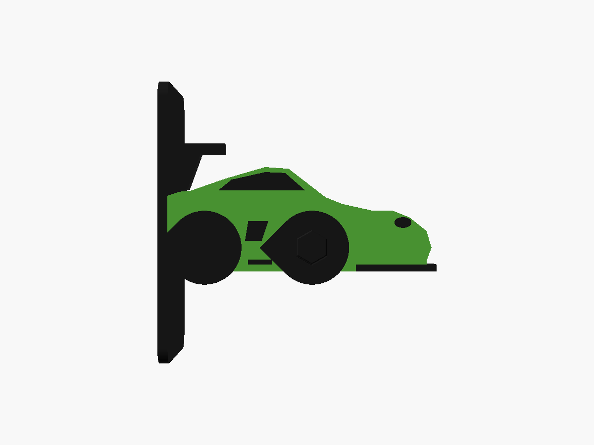
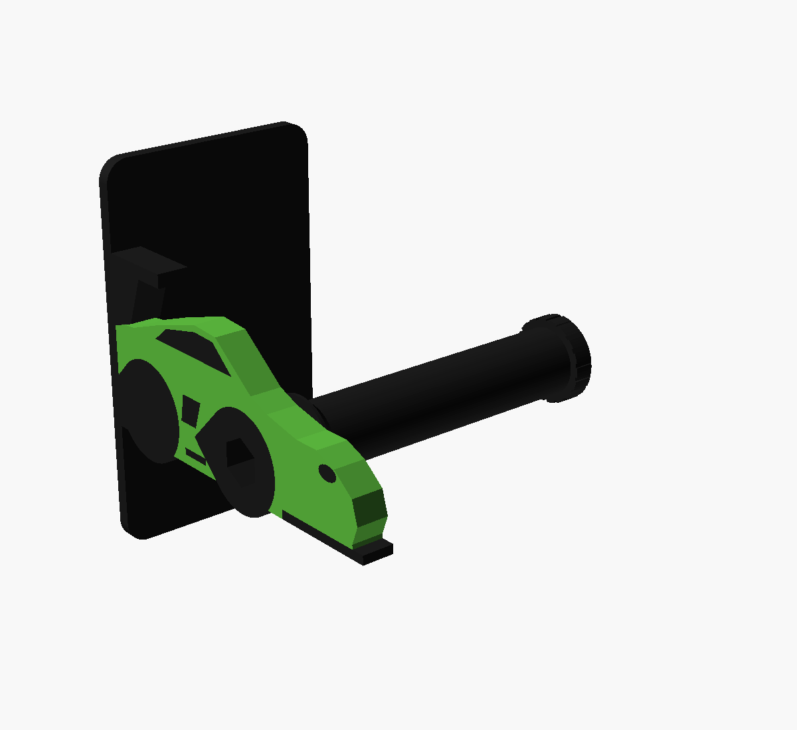
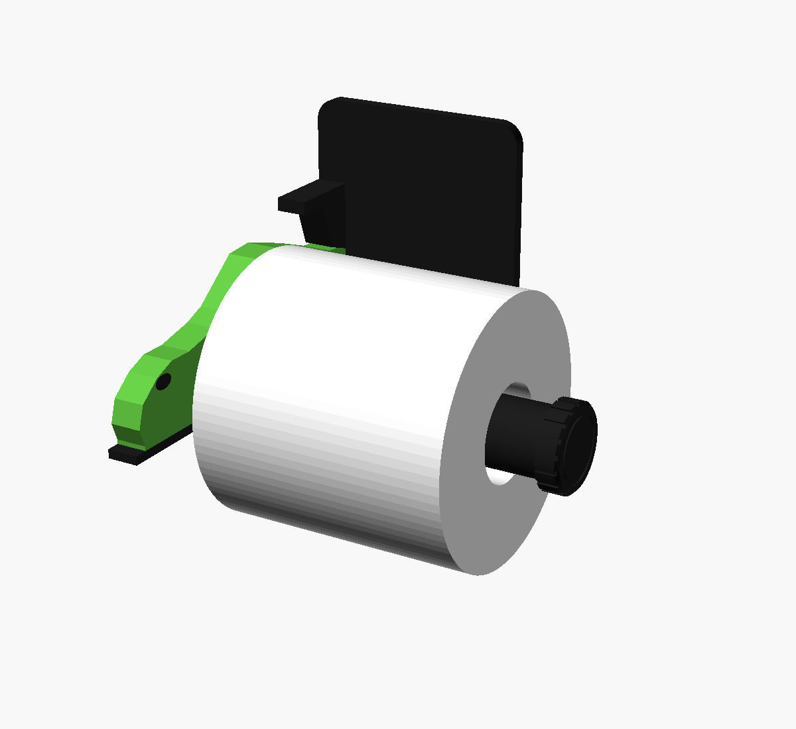

# 911 GT3 RS-style toilet paper holder

A green 911 GT3 RS-style car, with black accents, sticks out from a black wall plate. The car's front wheel is the axle, and the roll slides on from the open end. It mounts with 3M Command strips, so you don't drill any holes.

## Files

| File | What it is | Colour |
|---|---|---|
| `base.stl` | Wall plate and car in one piece (for a single-colour printer) | Black, then green from 6 mm up |
| `base_green.stl` + `base_black.stl` | The same base split by colour, for a multi-colour printer (AMS, MMU and similar) | Green / black |
| `axle.stl` | Roll bar with a hex peg and a tire-tread end cap | Black |
| `race_car_tp_holder.scad` | OpenSCAD source. You can change the car side, sizes and fit. | |

## Printing

- **Supports:** none needed. The car's wheels and edges are shaped to print without them.
- **Base:** print it as oriented, with the flat back of the plate on the bed. That keeps the back smooth so the strips stick well. You need a bed at least 100 x 170 mm and about 166 mm of height.
  - **Single-colour printer:** add a filament change at **6.0 mm**. The plate prints black and the car prints green. Then paint the wheels, wing, windows, splitter and headlight with a black paint marker. The windows, intake and headlight are recessed 0.8 mm, which makes them easy to paint.
  - **Multi-colour printer:** load `base_green.stl` and `base_black.stl` together and keep them as **one object with two parts**. Then assign the colours.
- **Axle:** print it standing up, tire end on the bed (158 mm tall).
- **Settings:** PETG or PLA, 4 walls, 25%+ infill. Use PETG for a steamy bathroom.

## Assembly

1. Push the axle's hex peg into the hex hole in the car's front wheel from the inside (the side facing the roll). It should end flush, like a centre-lock wheel nut.
2. Glue it in with superglue or 2-part epoxy.

## Mounting

- Use **4 pairs of Command Large picture-hanging strips** (rated 16 lb / 7 kg per 4 pairs). Lay them sideways across the back of the plate, spread from top to bottom.
- Clean the wall with rubbing alcohol. Press the plate firmly for 30 s, then wait **1 hour** before you hang a roll.
- The car is on the left by default. To put it on the right, set `car_side = "right"` in the `.scad` file and export again.

## Fit

- Holds standard and mega rolls up to 150 mm across and 128 mm wide. Roll cores are about 42 mm inside, and the bar is 30 mm.
- If the hex peg is too tight or too loose, change `hex_clear` (default 0.4 mm).
