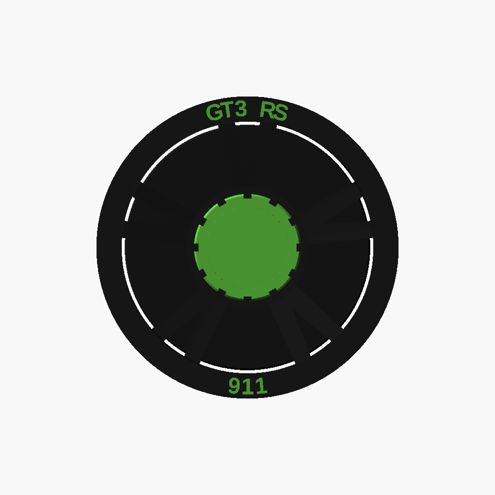
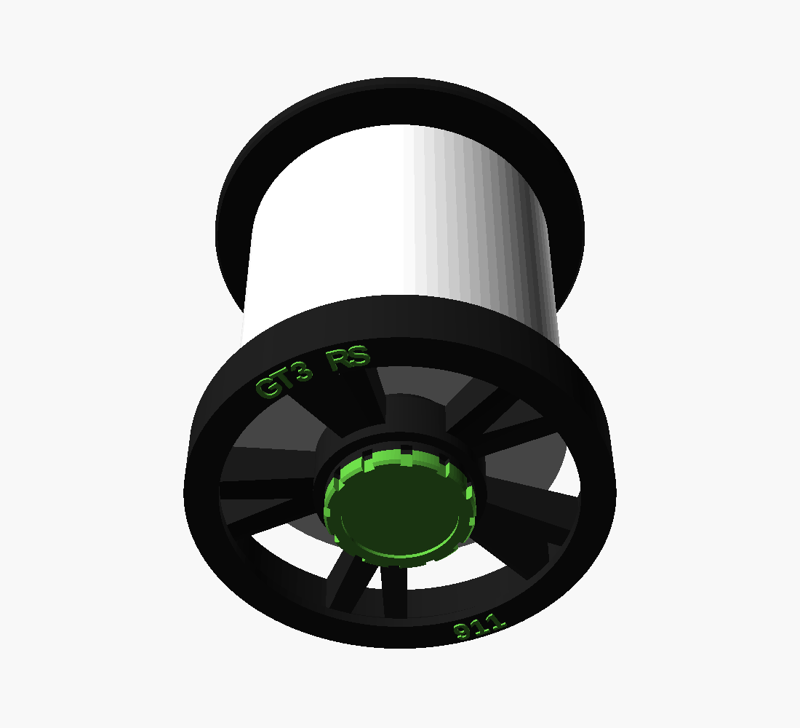

# GT3 RS-style wheel toilet paper holder

A wall disc with a post, plus a 10-spoke (5 double-spoke) wheel with a centre-lock nut. The roll slides onto the post, and then the wheel pushes onto the end of the post. Pull the wheel off to change the roll. The holder mounts with 3M Command strips.

## Files

| File | What it is |
|---|---|
| `wall.stl` | Wall disc (150 mm) and post |
| `wheel.stl` | The wheel in one piece |
| `wheel_body.stl` + `wheel_letters.stl` | The same wheel split in two colours, for a multi-colour printer. Load them together as one object. |
| `wheel_tp_holder.scad` | OpenSCAD source, for changing the text, emblem size, fit and sizes |

## Logo / emblem

The Porsche crest is **not** modelled. Instead, the centre-lock nut has a round pocket (40 mm wide, 1.4 mm deep) for a real emblem. Use a self-adhesive wheel centre-cap emblem or sticker. Measure yours and set `emblem_d` in the `.scad` file if it's a different size, then export the wheel again.

The rim says **GT3 RS** at the top and **911** at the bottom. You can change both (`top_text`, `bottom_text`).

## Printing (no supports)

- **Wall + post:** print with the disc down. That keeps the back smooth so the strips stick well. It's 146 mm tall.
- **Wheel:** print with the back down and the face up. It's 148 mm wide and 28 mm tall.
  - **Two colours on a single-colour printer:** add a filament change at **22.2 mm**. The rim lettering and the centre-lock nut then print in the second colour (for example, a black wheel with green lettering and nut).
- **Settings:** PETG or PLA, 4 walls, 20–25% infill. Use PETG if the bathroom gets steamy.
- **Fit:** the end of the post is tapered so the wheel wedges on snugly. If it's too tight or too loose, change `fit_clear` (default 0.3 mm).

## Mounting

- Use **4 pairs of Command Large picture-hanging strips**. Lay them sideways across the back of the disc, spread top to bottom.
- Clean the wall with rubbing alcohol. Press the disc firmly for 30 s, then wait **1 hour** before you hang a roll.
- It fits rolls up to 128 mm wide. The post is 32 mm, and roll cores are about 42 mm inside.
